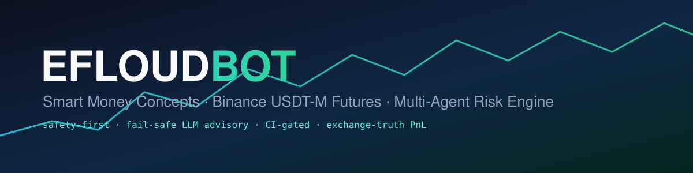
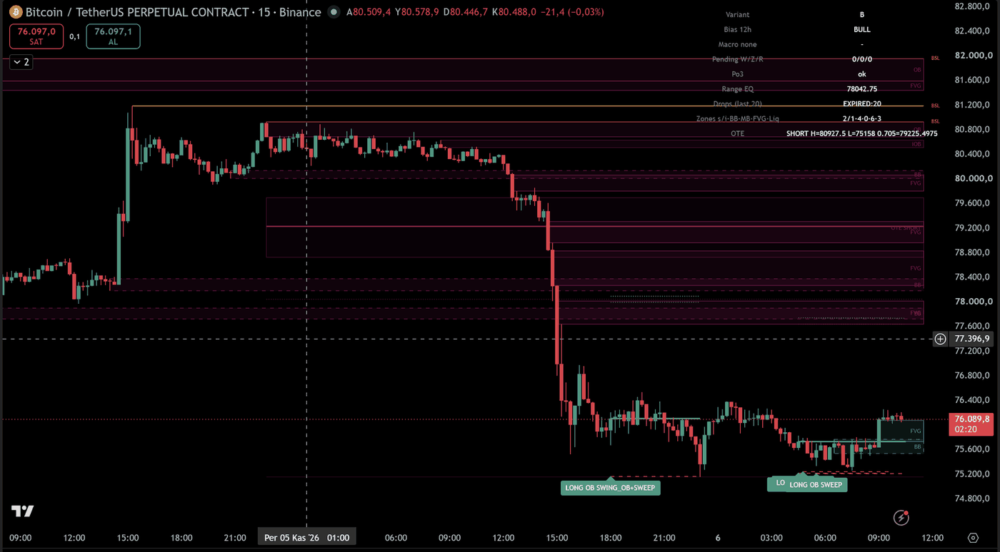
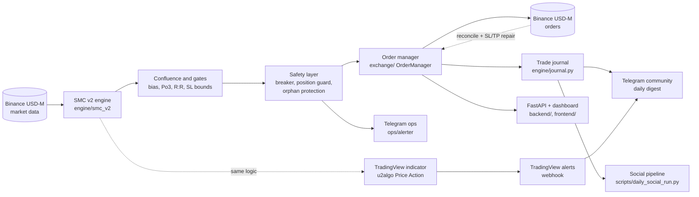
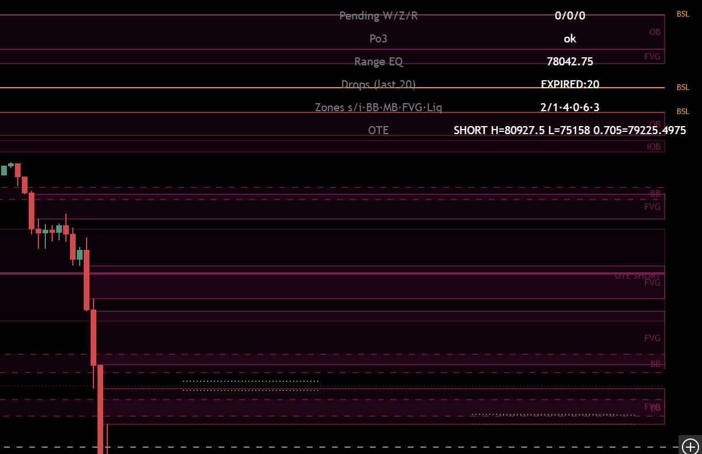
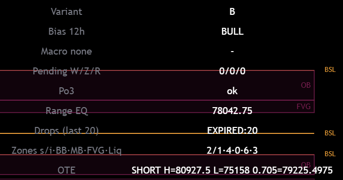

<p align="center">
  
</p>

# u2algo / EFloud Bot

[](https://github.com/Leblepito/efloud-bot/actions/workflows/ci.yml)

**EFloud Bot** is an autonomous trading bot for **Binance USD-M Futures** built on
**Smart Money Concepts (SMC)** price action: higher-timeframe bias, CHoCH/BOS structure
breaks, order-block and OTE pullback entries, and liquidity-based targets. It runs as a
Python service (CCXT + FastAPI) with an operator dashboard and a multi-layer safety
system. Its signal logic is mirrored in **u2algo Price Action**, an open-source
TradingView indicator, so the same zones and signals can be followed on any chart.

<p align="center">
  
  <br>
  <sub>u2algo Price Action on BTCUSDT.P (15m): order blocks, breakers, FVGs, liquidity, OTE band and a LONG signal with Entry / SL / TP.</sub>
</p>

> [!WARNING]
> This software places real orders with leverage. It is not financial advice.
> Start on **testnet with `dry_run: true`** and read the [safety section](#safety-and-disclaimer) first.

## What it does

- **Trading bot** — SMC v2 signal engine (`engine/smc_v2/`, LuxAlgo-based structure):
  HTF LuxAlgo swing bias → CHoCH/BOS break → pullback (retest) into the break's order block →
  engulfing close on the entry timeframe → **market** entry (`exchange/__init__.py:1151-1153`);
  SL beyond the OB edge with an ATR-banded buffer (`calc_sl`), TP1 = nearest LuxAlgo candidate
  at ≥ `risk.min_rr`. Live switches: `configs/config.phase2_1k.yaml:180-188`; details in `CONTEXT.md`.
- **Safety layer** — circuit breaker (daily / weekly loss limits), position guard,
  orphan protection, mainnet guard, reconcile and SL/TP repair (`engine/safety/`).
- **Dashboard** — FastAPI backend serving a Next.js static dashboard: status, breaker,
  balance, live chart with SMC overlay, positions, trade history, research, config.
- **TradingView indicator** — *u2algo Price Action* (Pine v6) draws the same zones and
  signals and emits alert JSON or Telegram-ready messages.
- **Telegram** — an operator alert channel and a public community channel.
- **Social pipeline** — turns journaled signals into branded charts, short videos and
  captions, gated by compliance checks and dry-run publishing by default.

## Architecture



The orchestrator (`engine/safe_orchestrator.py`) drives the loop; `backend/bot_runner.py`
runs it inside the FastAPI process. The Pine indicator is generated from `pine/lab/*`
and checked for parity against the Python engine (see [Development](#development)).

## Quick start

**Requirements:** Python **3.11** (`pyproject.toml`: `>=3.11,<3.13`), Node.js **20+**
(dashboard build), Docker with Compose (recommended), a Binance Futures API key
(testnet keys from <https://testnet.binancefuture.com>).

### 1. Clone and configure

```bash
git clone https://github.com/Leblepito/efloud-bot.git
cd efloud-bot
cp .env.example .env   # fill in API keys, DASHBOARD_PASSWORD, SESSION_SECRET
```

Secrets live only in `.env` (git-ignored). The template defaults to
`EFLOUD_CONFIG_PATH=configs/config.testnet.yaml`, `EFLOUD_ALLOW_MAINNET=0` and
`EFLOUD_AUTOSTART=0`.

### 2. Run with Docker (single bot + dashboard)

```bash
docker compose up -d --build
```

Open <http://localhost:8080>, log in with `DASHBOARD_PASSWORD`, then press **Start**.
The container exposes `/healthz` for health checks.

### 3. Run locally without Docker

```bash
python -m venv .venv && . .venv/bin/activate          # Windows: .venv\Scripts\activate
pip install -r requirements.txt -c constraints.txt
npm ci && npm run build --workspace efloud-frontend   # dashboard -> frontend/out
uvicorn backend.main:app --port 8080
```

### 4. Run the tests

```bash
python -m pytest -q                       # same entry point as CI (pytest, py3.11)
npm run test --workspace efloud-frontend  # dashboard unit tests (vitest)
```

### Production (VPS)

Production uses `docker-compose.prod.yml` (multiple bot profiles, Caddy with automatic
HTTPS, autoheal, alerter, overseer, scheduled routines) and the scripts in `deploy/`.
Follow [`deploy/HETZNER_GUIDE.md`](deploy/HETZNER_GUIDE.md) and
[`docs/runbooks/operator-runbook.md`](docs/runbooks/operator-runbook.md); other runbooks are in [`docs/runbooks/`](docs/runbooks/).
The environment template is [`deploy/.env.production.example`](deploy/.env.production.example).

## Configuration

| Config | Used by | Mode |
|---|---|---|
| `config.yaml` (repo root) | CLI default (`python main.py`) when `EFLOUD_CONFIG_PATH` is unset | testnet, `dry_run: true` |
| `configs/config.testnet.yaml` | `.env.example` default | testnet |
| `configs/config.phase2_1k.yaml` | **Production** (`EFLOUD_CONFIG_PATH=configs/config.phase2_1k.yaml`) | **mainnet, `dry_run: false`** |
| `configs/config.phase2_long_1k.yaml`, `configs/config.phase2_scalp_1k.yaml` | Long / scalp bots (`deploy/.env.production.long.example`, `.scalp.example`) | mainnet |

> [!IMPORTANT]
> The root `config.yaml` is **not** the live config. Production always sets
> `EFLOUD_CONFIG_PATH=configs/config.phase2_1k.yaml`. The dashboard backend also
> falls back to that file when the variable is unset, so always set it explicitly.

- **Dry-run vs mainnet:** live orders need `testnet: false` **and** `dry_run: false`
  in the config **and** `EFLOUD_ALLOW_MAINNET=1` in the environment; otherwise the
  mainnet guard (`engine/safety/guard.py`) blocks startup.
- **Safety defaults (live config):** daily loss limit 10 % trips the breaker, weekly
  drawdown 25 % halts it, orphan protection on. Effective concurrent positions =
  ⌊`max_total_exposure` × balance / per-position notional⌋ (`engine/safety/position_guard.py:271-282`);
  `max_open_positions` is only an upper bound — at the configured `starting_balance`
  (`configs/config.phase2_1k.yaml:375,403`) the exposure cap binds first.
  `EFLOUD_AUTOSTART=0` keeps the bot idle after a restart until an operator starts it.
- **Timeframe profiles:** `scalp`, `mid`, `long` entry/structure/trend chains are
  defined in `data/timeframes.py`.

## TradingView indicator — u2algo Price Action

<p align="center">
  
  
</p>

| Layer | What it shows |
|---|---|
| **OB / iOB** | Swing and internal order blocks left before a structure break |
| **BB / MB** | Breaker (prior swing swept) and mitigation block (failed swing) after an OB is broken |
| **FVG** | Three-candle fair value gaps, removed once mitigated |
| **BSL / SSL / EQH / EQL** | Liquidity pools; ★ marks volume-confirmed levels, swept levels end at the sweep bar |
| **OTE** | Fixed-range 0.618–0.786 band with 0.705 and EQ (50 %) |
| **LONG / SHORT** | CHoCH/BOS → OB pullback → engulfing confirmation, filtered by 12h bias and Po3 gate, with Entry / SL / TP lines |
| **Dashboard** | Current bias, structure and signal state in a table |

The indicator is display-only and places no orders; not every indicator signal is a bot
trade, because the bot applies extra risk gates.

- User guide: [`docs/indicator/u2algo-price-action.md`](docs/indicator/u2algo-price-action.md)
- Publish kit: [`docs/indicator/tradingview-publish.md`](docs/indicator/tradingview-publish.md)
- **TradingView:** _link added after publication_ <!-- TV_URL -->
- **Licence:** the structure engine is adapted from "Smart Money Concepts (SMC) [LuxAlgo]"
  (© LuxAlgo, **CC BY-NC-SA 4.0**). The indicator is published open-source under the
  same licence, for non-commercial use. See [`THIRD_PARTY_NOTICES.md`](THIRD_PARTY_NOTICES.md).

## Telegram

| Channel | Source | Content |
|---|---|---|
| **Ops (operator)** | `ops/alerter` and `backend/notifications/` (`EFLOUD_TELEGRAM_*`) | Breaker trips, `/healthz` failures, drawdown and position alerts (full detail: size, USD PnL) |
| **Community (public)** | `engine/notifications/telegram_notifier.py` (`EFLOUD_CUSTOMER_TG_*`, default off) and TradingView indicator alerts | Aggregate daily digest of closed trades; indicator signals via TradingView webhook; optional real-time bot trade posts (`EFLOUD_CUSTOMER_TG_TRADES`, default off, PR #298 — see `docs/telegram/community-channel.md` once merged) |

Setup for indicator alerts: [`docs/telegram/tradingview-to-telegram.md`](docs/telegram/tradingview-to-telegram.md).
Bot tokens are never stored in the repository.

## Repository layout

```text
backend/        FastAPI app, bot runner, auth, DB, healthz, social content queue
engine/         Orchestrator, SMC v1 + v2 engine (engine/smc_v2), confluence, journal
  safety/       Circuit breaker, position guard, orphan protection, mainnet guard
exchange/       Binance client, OrderManager, reconcile, websocket klines
risk/           Position sizing (risk-based, notional cap, fixed mode)
data/           OHLCV fetcher, cache, timeframe profiles
configs/        Bot configs (phase2_1k = live, testnet = trial)
frontend/       Next.js operator dashboard (static export served by the backend)
panel/          Unified panel service (docker-compose.panel.yml)
pine/           TradingView Pine v6 sources; pine/lab/* builds pine/efloud_lab.pine
ops/            Telegram alerter, overseer, daily report, social webhooks
scripts/        Routines, Pine build/parity tools, social pipeline, utilities
deploy/         Caddy, setup/deploy scripts, env templates, backups
docs/           Operator guide, runbooks, indicator and Telegram guides, specs
tests/          pytest suite (plus backend/tests)
collab/         Shared hub for the AI agents working on this repo
agents/, skills/, hooks/   Desk agent roles, skills and the live-write gate hook
u2algo-site/    Marketing site (Railway service)
```

## Development

- **Test first.** Every change follows TDD: a failing test, a minimal diff, then the
  relevant gate (risk review for `engine/safety/`, `engine/risk/`, `exchange/` and the
  `safety:` / `risk:` config blocks; a net-cost backtest for edge or scoring changes).
  New behaviour ships behind a toggle that is **off by default**.
- **Tests:** `python -m pytest -q`. Fast Pine subset:

  ```bash
  python -m pytest -q tests/test_pine_lab_build.py tests/test_pine_lab_parity.py \
    tests/test_pine_lab_visuals.py tests/test_pine_lab_variant.py
  ```

- **Pine build flow:** edit `pine/lab/*`, never the generated files, then

  ```bash
  python scripts/build_pine_lab.py           # writes pine/efloud_lab.pine + pine/efloud_lab_strategy.pine
  python scripts/build_pine_lab.py --check   # exits 1 if committed outputs are stale
  ```

  Parity against the Python engine: [`docs/pine-lab/README.md`](docs/pine-lab/README.md).
  Pine v6 syntax only; indicator and strategy keep the same input names.
- **AI collaboration:** agent instructions are in [`AGENTS.md`](AGENTS.md),
  [`CLAUDE.md`](CLAUDE.md) and [`collab/models/`](collab/models/) (Hermes: `hermes.md`); the shared task hub is
  [`collab/`](collab/README.md).
- **Contributing:** use a feature branch and a pull request; keep PRs atomic, never
  weaken a safety guard, and never commit secrets (CI runs gitleaks).
  Change history: [`CHANGELOG.md`](CHANGELOG.md).

## Safety and disclaimer

Trading leveraged futures can lose more than the money in your account. This project is
provided for research and education; it is **not financial advice** and past results do
not guarantee future results. You are responsible for your API keys, configuration and
every order the bot places. Use testnet and `dry_run` first, restrict API keys
(no withdrawals, IP allow-list), and keep the circuit breaker enabled.

## Licence

- **Bot code:** this repository does not currently include a `LICENSE` file, so no
  open-source licence is granted for it; default copyright applies.
- **Third-party code:** parts of the desk plugin (`hooks/live_write_gate.py`, `agents/*.md`,
  `skills/desk-operating-model/`) are adapted from HyperGrok Trading Desk under the MIT
  licence; see [`THIRD_PARTY_NOTICES.md`](THIRD_PARTY_NOTICES.md).
- **TradingView indicator:** CC BY-NC-SA 4.0, derived from LuxAlgo's Smart Money Concepts.
