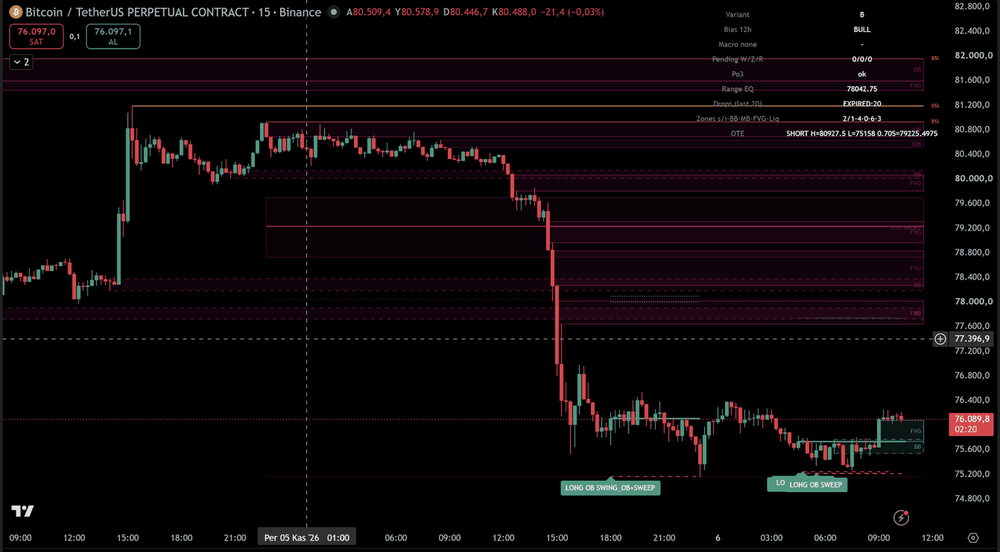
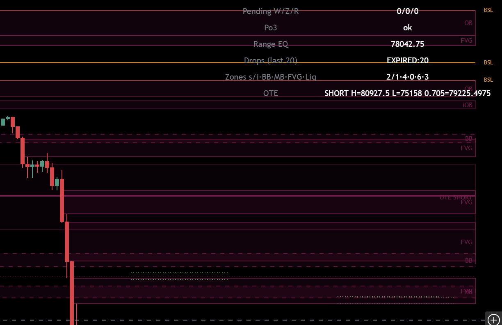
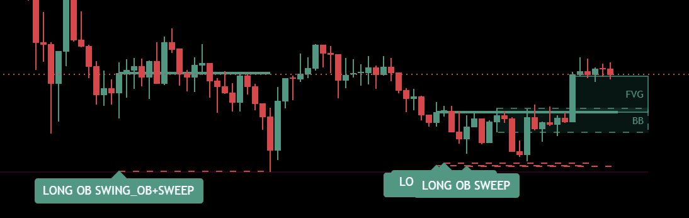
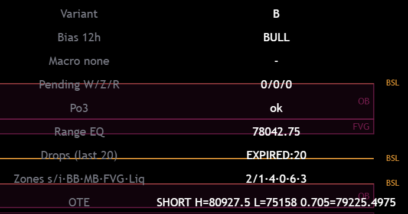

# u2algo Price Action — Kullanım Rehberi

<!-- TV_URL -->
TradingView sayfası: _yayından sonra eklenecek_

## 1. Nedir?

**u2algo Price Action**, u2algo botunun kullandığı Smart Money Concepts (SMC) fiyat hareketi bölgelerini grafiğinizde gösteren bir TradingView göstergesidir: Order Block'lar, Breaker/Mitigation blokları, Fair Value Gap'ler, likidite havuzları, OTE bölgesi ve botun sinyal mantığını yansıtan LONG/SHORT işaretleri.

Gösterge **emir vermez**. Bölgeler yalnızca görüntüdür; karar sizindir.

## 2. Hızlı başlangıç

1. TradingView'de **Indicators** menüsünde "u2algo Price Action" araması yapın ve grafiğe ekleyin.
2. Önerilen zaman dilimi **15 dakika** (botun giriş zaman dilimi). Önerilen semboller: BTCUSDT.P, ETHUSDT.P gibi likit USDT perpetual çiftleri.
3. Temiz bir grafikle başlayın; yalnızca bu gösterge açık olsun. Gerekirse ayarlardan katmanları tek tek kapatın.
4. Sağ üstteki **dashboard** tablosundan anlık durumu okuyun (bkz. bölüm 4).

## 3. Katmanlar ve nasıl okunur

### Order Block (OB / iOB)
Yapı kırılımından önceki, kurumsal emir bıraktığı varsayılan son zıt mum bölgesi. **OB** swing ölçeğinde (uzun), **iOB** internal ölçekte (kısa) oluşan bloktur. Renk yönü gösterir (boğa/ayı). Fiyat bloğa geri döndüğünde tepki beklenir. Aktif (henüz mitigate olmamış) bloklar çizilir; "History" ayarı açıksa mitigate olanlar soluk gösterilir (`OB ✓`).

### Breaker (BB) ve Mitigation Block (MB)
Bir OB, fiyat tarafından kapanışla delindiğinde yön değiştirir ve yeni yönde bir blok olur:
- **BB (Breaker):** OB'den önceki swing seviyesi süpürüldüyse (likidite alındıysa) ve ardından OB delindiyse.
- **MB (Mitigation Block):** önceki swing süpürülmeden, yani **başarısız swing** ile dönüldüyse.

Kısaca: önceki swing süpürüldü → **BB**; süpürülmedi, higher-low / lower-high ile döndü → **MB**. Fiyat bloğun karşı tarafında kapanış yaptığında blok artık çizilmez.

### Fair Value Gap (FVG)
Üç mumluk hareketteki dengesiz boşluk. İnce, şeffaf kutu olarak `FVG` yazısıyla gösterilir; fiyat çoğu zaman bu boşluğu doldurmaya döner. Mitigate olan FVG'ler kaldırılır.

### Likidite: BSL / SSL / EQH / EQL

- **BSL / SSL:** swing tepelerinin üstündeki (Buy-Side) ve diplerinin altındaki (Sell-Side) likidite. Stop emirlerinin biriktiği yerler.
- **EQH / EQL:** eşit tepeler / eşit dipler; aynı seviyede biriken likidite.
- Çizgiler nötr renktedir: yön değil **hedef** gösterir.
- **★ hacim teyidi:** seviyeyi oluşturan hareket aynı yönde en az 3 ardışık barda artan hacimle gelmiş ve son barın hacmi 60 barlık ortalamanın üstündeyse çizgi kalınlaşır ve etikete ★ eklenir.
- **Swept (süpürülmüş) geçmiş:** fiyat seviyeyi aldığında çizgi o barda biter. "History" ayarı açıksa son 5 süpürülmüş seviye kesikli ve soluk gösterilir.

### OTE (Optimal Trade Entry)
Güncel swing aralığı **sabit** tutulur (aralık içindeki barlar onu değiştirmez; yalnızca yeni bir uç fitil aralığı uzatır). Gösterilenler: **0.618–0.786 bandı**, **0.705** çizgisi ve **EQ** (orta, %50). Yön, aralığın iki ucunun sırasına göre belirlenir: tepe daha sonra oluştuysa LONG (geri çekilmede alış bölgesi), dip daha sonra oluştuysa SHORT. Yalnızca güncel aralık çizilir.

### Sinyaller: LONG / SHORT, Entry / SL / TP
Bir sinyal şu zincirle üretilir:
1. Yapı kırılımı (**CHoCH** veya **BOS**) bir aday bölge (OB tabanlı) doğurur.
2. Fiyat bölgeye **geri çekilir (pullback)**.
3. Bölgede **engulfing (yutan mum) teyidi** gelir ve bar kapanır.

Ek kapılar: **HTF yön filtresi** (varsayılan 12 saatlik bias; yön ters ise sinyal engellenir), **Po3 kapısı** (manipülasyon durumunda sinyal verilmez), minimum R:R, SL mesafe sınırları ve premium/discount şartı. Sinyal çıkınca grafikte `LONG`/`SHORT` etiketi ile Entry (kalın), SL (kesikli kırmızı) ve TP1/TP2 (noktalı yeşil) çizgileri görünür.

## 4. Dashboard

| # | Satır | Anlamı |
|---|---|---|
| 1 | Variant | Çalışan mantık varyantı (varsayılan: botun canlı mantığı). |
| 2 | Bias 12h | HTF yön: BULL / BEAR / UNDEF. Ters yönlü sinyaller engellenir. |
| 3 | Macro | İsteğe bağlı üst zaman dilimi yönü (varsayılan kapalı, "-"). |
| 4 | Pending W/Z/R | Bekleyen adaylar: W = pullback bekliyor, Z = bölgede, R = yeniden giriş bekliyor. |
| 5 | Po3 | `ok` veya `MANIPULATION (blocked)`; engel varsa yeni sinyal yok. |
| 6 | Range EQ | Güncel trend aralığının orta fiyatı. |
| 7 | Drops (last 20) | Son 20 adayın neden elendiği (neden: adet). |
| 8 | Zones | Çizilen bölge sayıları: swing/internal OB · BB · MB · FVG · Likidite. |
| 9 | OTE | Güncel OTE yönü ve seviyeleri. |

## 5. Ayarlar (Inputs)

**Görsel**

| Ayar | Varsayılan | Anlamı |
|---|---|---|
| Active OB boxes | Açık | Aktif OB kutuları |
| Pending candidate zones | Açık | Sinyal bekleyen aday bölgeler |
| Entry/SL/TP lines | Açık | Sinyal çizgileri |
| Dashboard | Açık | Sağ üst tablo |
| Kept signal drawings | 60 | Grafikte tutulan sinyal çizimi sayısı (4–100) |

**SMC bölgeleri (yalnız görüntü)**

| Ayar | Varsayılan | Anlamı |
|---|---|---|
| Breaker / Mitigation blocks (BB/MB) | Açık | BB/MB kutuları |
| FVG boxes | Açık | FVG kutuları |
| Liquidity levels (EQH/EQL/BSL/SSL) | Açık | Likidite çizgileri |
| OTE range | Açık | 0.618–0.786 bandı, 0.705, EQ |
| History | Kapalı | Mitigate OB ve süpürülmüş seviyeler (soluk) |
| OB/BB/MB boxes from candle body | Kapalı | Kutuları fitil yerine mum gövdesinden çiz |
| Volume-confirmed liquidity (★) | Açık | Hacim teyidi |
| Nearest zones per side | 8 | OB, BB/MB ve FVG katmanlarında her yönde en yakın bölge sayısı (1–200). Likidite katmanı sabittir: en yakın 10 süpürülmemiş seviye. |
| Bull / Bear / Liquidity colour | teal / maroon / orange | Renkler |
| Zone fill transparency | 85 | Dolgu şeffaflığı (0–100) |

**Telegram alerts**

| Ayar | Varsayılan | Anlamı |
|---|---|---|
| Telegram chat id | boş | Boşsa bot JSON'u; doluysa Telegram mesajı |
| Message footer | u2algo Price Action | Mesaj altlığı |

**Baseline (canlı bot)** — botun canlı yapı/sinyal parametreleri; değiştirmek göstergeyi bottan ayırır.

| Ayar | Varsayılan | Anlamı |
|---|---|---|
| Swing length | 50 | Swing pivot uzunluğu |
| Internal length | 5 | Internal yapı uzunluğu |
| Equal H/L length / threshold | 3 / 0.1 (×ATR200) | EQH/EQL tespiti |
| OB filter = ATR | Açık | Kapalıyken kümülatif ortalama aralık |
| OB mitigation = HIGHLOW | Açık | Kapalıyken kapanış (CLOSE) |
| FVG auto threshold | Açık | Otomatik FVG eşiği |
| Trigger kind: CHoCH / BOS | Açık / Açık | Hangi kırılımlar aday üretir |
| Use internal / swing breaks | Açık / Açık | Hangi ölçekteki kırılımlar |
| Require premium/discount | Açık | Alış discount'ta, satış premium'da |
| Min confluence tags | 1 | Minimum confluence etiketi |
| Recency window | 168 bar | Kırılımın geçerlilik süresi |
| Max zone distance | 12 ×ATR14 | Bölgenin azami uzaklığı (0 = kapalı) |
| Max zone overshoot | 6 ×ATR14 | Bölge aşım toleransı |
| Pullback timeout | 48 bar | Geri çekilme bekleme süresi |
| Max pending candidates | 6 | Aynı anda bekleyen aday sayısı |
| SL buffer | 0.5 ×ATR14 | SL tamponu |
| Min / Max SL distance | 2.0 / 5.0 ×ATR14 | Dar SL genişletilir; geniş SL reddedilir |
| Min R:R for TP1 | 1.8 | Minimum risk/ödül |
| TP liquidity wick buffer | 0.15 R | TP likidite fitil tamponu |
| Po3 manipulation gate | Açık | Po3 kapısı |
| Po3 accumulation start / end | 0 / 8 (UTC saat) | Akümülasyon penceresi |
| Po3 displacement | 1.5 ×SMA(range,20) | Manipülasyon eşiği |
| HTF swing length (bias) | 50 | HTF bias swing uzunluğu |
| Live kline window | 750 bar | Botun canlı mum penceresi |

**Geliştirmeler (varsayılan KAPALI)** — deneysel; kapalıyken davranış botla aynıdır.

| Ayar | Varsayılan | Anlamı |
|---|---|---|
| T1 Bias TF / mode | 12h / hard | Bias zaman dilimi (4h, 12h, 1d) ve katı/yumuşak mod |
| T1 Macro TF | none | Ek makro yön (yumuşak, +1 etiket) |
| T2 OB invalidation + Breaker | Kapalı | OB iptali ve breaker üretimi |
| T3 OTE 0.705 limit entry | Kapalı | 0.705'ten limit giriş |
| T4 Sweep-aware SL anchor | Kapalı | SL'yi süpürme ucuna çapala |
| T5 Fresh confirmation | Kapalı | Teyit yalnız son barda |
| T6 OB needs displacement FVG | Kapalı | OB için displacement FVG şartı |
| T7 Drop swept TP levels | Kapalı | Süpürülmüş TP seviyelerini ele |
| T8 Emit each break once | Kapalı | Her kırılım için tek sinyal |

## 6. Alertler

Gösterge, onaylanmış her sinyalde bar kapanışında tek bir `alert()` üretir. Alert oluştururken Condition olarak **u2algo Price Action → Any alert() function call** seçin.

- **Bot JSON modu** (Telegram chat id boş): sembol, yön, entry, SL, TP1, TP2 içeren JSON.
- **Telegram modu** (chat id dolu): mesaj doğrudan Telegram `sendMessage` biçimindedir; webhook ile Telegram'a gönderilir.

Kurulum adımları ve sorun giderme: [`docs/telegram/tradingview-to-telegram.md`](../telegram/tradingview-to-telegram.md). Her sembol/zaman dilimi için ayrı alert gerekir; webhook için ücretli TradingView planı gerekir.

## 7. Sınırlar ve dürüstlük

- Bölgeler **yalnızca görüntüdür**; tek başına işlem sinyali değildir.
- Sinyaller botun canlı v2 (LuxAlgo tabanlı) mantığını, botun 10 canlı sembolünde yansıtır. Bot ayrıca risk kapıları ve pozisyon limitleri uygular; bu yüzden **her gösterge sinyali bir bot işlemi değildir**.
- Geçmiş performans veya backtest sonuçları gelecek için söz değildir.
- Bu gösterge **yatırım tavsiyesi değildir**. Vadeli işlemler yüksek risk taşır; kaybedebileceğinizden fazlasını riske atmayın.
- Çizimler bar kapanışında kesinleşir; açık barda değişebilir.

## 8. Lisans ve kaynaklar

Yapı motoru, LuxAlgo'nun "Smart Money Concepts (SMC) [LuxAlgo]" göstergesinden uyarlanmıştır; © LuxAlgo, **CC BY-NC-SA 4.0** lisansı. Bu gösterge de aynı lisansla, **açık kaynak ve ticari olmayan** biçimde yayımlanır; ücretli veya davetli sürümü yoktur. Ayrıntı: [`THIRD_PARTY_NOTICES.md`](../../THIRD_PARTY_NOTICES.md).

---

## English summary

**u2algo Price Action** is an open-source TradingView indicator (CC BY-NC-SA 4.0, structure engine adapted from "Smart Money Concepts (SMC) [LuxAlgo]") that draws the SMC zones used by the u2algo bot: order blocks (OB/iOB), breaker and mitigation blocks (BB/MB), fair value gaps, volume-confirmed liquidity (BSL/SSL/EQH/EQL), a fixed-range OTE band (0.618-0.786, 0.705, EQ) and LONG/SHORT signals with Entry/SL/TP lines. Signals require a CHoCH/BOS, an order-block pullback and an engulfing confirmation, filtered by a 12h bias and a Po3 gate. Alerts come as bot JSON or Telegram-ready messages. Zones are display-only; not every signal is a bot trade because the bot applies additional risk gates. Not financial advice; past results are no guarantee. Recommended: 15m on liquid USDT perpetuals.
